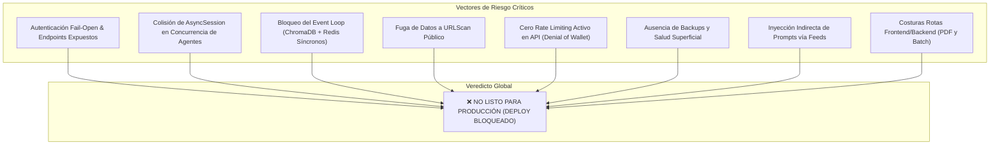

# Reporte Maestro de Auditoría Integral: ThreatChain

**Orquestador:** `full-audit-orchestrator`  
**Fecha de Auditoría:** 12 de Septiembre de 2026  
**Entorno de Ejecución:** Anaconda Environment `ThreatChain` (Python 3.12.13 en `C:\Users\coral\anaconda3\envs\ThreatChain\python.exe`)  
**Stack Principal:** FastAPI, SQLAlchemy 2.0 (psycopg async), PostgreSQL 16, Redis 7, ChromaDB, LangChain 0.3, LangGraph 0.2, Streamlit UI, Docker.

---

## 1. Resumen Ejecutivo

ThreatChain implementa una arquitectura funcional ambiciosa y bien estructurada para la automatización de análisis SOC Nivel 1, orquestando 7 agentes especializados y 17 herramientas de ciberinteligencia con correlación MITRE ATT&CK. 

Sin embargo, la auditoría integral realizada a través de **6 oleadas coordinadas y 10 agentes especialistas** ha determinado de forma unánime que el sistema **NO ESTÁ LISTO PARA PRODUCCIÓN**. Existen cuellos de botella de concurrencia en la base de datos, vulnerabilidades de autenticación perimetral (fail-open), fuga involuntaria de datos hacia fuentes públicas, bloqueos sincrónicos en el bucle asíncrono de FastAPI, desajustes de comunicación ("costuras") entre la interfaz de usuario y la API, y una falta total de automatización de copias de seguridad y observabilidad para entornos de producción.

---

## 2. Veredicto Global y Matriz de Estado

### ⚖️ Veredicto: **NO LISTO PARA PRODUCCIÓN (DEPLOY BLOQUEADO)**

Para autorizar el pase a producción y exposición en un VPS como SaaS, es mandatario resolver los **8 Bloqueantes Absolutos (P0)** y corregir los **Riesgos Altos (P1)** descritos en este informe.

### Cobertura de Especialistas Invocados

| Oleada | Agente Especialista | Rol Evaluado | Severidad Máxima | Veredicto Particular |
|---|---|---|:---:|:---:|
| **1** | `security-auditor` | Seguridad, Auth, SSRF, Injection | 🔴 **CRÍTICO** | Vulnerable (Fail-open, Inyección de Prompt, Fuga de URLs) |
| **1** | `db-integrity-auditor` | Concurrencia, ACID, SQLAlchemy, Alembic | 🔴 **CRÍTICO** | Inseguro para concurrencia (Race conditions en sesión) |
| **1** | `code-optimizer` | Concurrencia async, HTTP pooling, DRY | 🔴 **CRÍTICO** | Cuellos de botella severos (Tools secuenciales, Redis sincrónico) |
| **1** | `llm-integration-auditor` | LangChain/LangGraph, Prompts, Tokens | 🔴 **CRÍTICO** | Modelo inexistente (`claude-sonnet-4-6`), Fallback sin backoff |
| **1** | `frontend-auditor` | Streamlit UI, Caching, UX Técnica | 🔴 **CRÍTICO** | Bucle zombi de 180s ante 4xx/5xx, Render eager de PDF |
| **2** | `architecture-reviewer` | Boundaries, Contratos, Estado LangGraph | 🔴 **CRÍTICO** | Persistencia filtrada en agentes, Grafo ficticio de 2 nodos |
| **3** | `qa-test-engineer` | Cobertura de tests, Fixtures, Mocks | 🔴 **CRÍTICO** | Pirámide invertida (114 tests unitarios, 0 tests de API) |
| **4** | `backend-health-auditor` | Manejo de excepciones, Lifespan, Resiliencia | 🔴 **CRÍTICO** | Sin Global Exception Handler, Falsos healthchecks |
| **4** | `observability-sre` | Logs, Métricas RED, Tracing, SLIs/SLOs | 🔴 **CRÍTICO** | Madurez 1.5/10 (Caja negra sin correlation IDs ni Prometheus) |
| **5** | `cazador-costuras` | Desajustes de cruce entre subsistemas | 🔴 **CRÍTICO** | 12 costuras identificadas (Descarga rota, Batch roto) |
| **6** | `prelaunch-auditor` | DevSecOps, Docker, Backups, TLS, Ready | 🔴 **CRÍTICO** | **DEPLOY BLOQUEADO** (8 bloqueantes absolutos) |

---

## 3. Patrones Transversales Críticos y Puntos Frágiles del Sistema

Tres patrones defectuosos fueron detectados independientemente por 3 o más especialistas, señalando los puntos de mayor fragilidad arquitectónica:

### 1. El Antipatrón de la Sesión de Base de Datos Compartida en `Coordinator`
* **Detectado por:** `db-integrity-auditor`, `code-optimizer`, `architecture-reviewer`, `cazador-costuras`, `prelaunch-auditor`.
* **Mecánica:** En `app/agents/coordinator.py`, los agentes (`ReconAgent`, `OsintAgent`, `MalwareAgent`) se lanzan concurrentemente con `asyncio.gather(*tasks)` compartiendo la misma instancia mutable `self.db` (`AsyncSession`). Cada agente y cada herramienta intenta invocar transacciones, queries e incrementos en `RateLimiter` al mismo tiempo.
* **Impacto:** Provoca excepciones no recuperables `sqlalchemy.exc.IllegalStateChangeError` o bloqueos en el driver de `psycopg`, truncando investigaciones y dejando estados inconsistentes.

### 2. Bloqueo Masivo del Event Loop de FastAPI por I/O Síncrono
* **Detectado por:** `code-optimizer`, `db-integrity-auditor`, `backend-health-auditor`, `architecture-reviewer`, `prelaunch-auditor`.
* **Mecánica:** 
  1. `get_redis_client()` usa el paquete síncrono `redis.Redis` en lugar de `redis.asyncio`.
  2. La búsqueda vectorial en ChromaDB (`mitre_similarity_search`) y la generación de embeddings de OpenAI se ejecutan sincrónicamente en el hilo principal sin `asyncio.to_thread`.
  3. La exportación de PDF con ReportLab corre en el hilo asíncrono.
* **Impacto:** Bajo concurrencia, una sola búsqueda de tácticas MITRE o lectura de caché congela el servidor completo durante 0.5s a 2.5s, degradando WebSockets y rechazando pings HTTP.

### 3. Autenticación y Control de Acceso Permisivo ("Fail-Open")
* **Detectado por:** `security-auditor`, `frontend-auditor`, `backend-health-auditor`, `observability-sre`, `prelaunch-auditor`.
* **Mecánica:** Si `API_KEY` está vacía en `.env`, `app/api/auth.py` permite el paso sin validar. Además, los endpoints `GET /investigations`, `GET /reports`, la descarga de reportes y los WebSockets no tienen declarada ninguna dependencia de autenticación.
* **Impacto:** Fuga completa de la base de conocimiento del SOC y de investigaciones corporativas confidenciales para cualquier usuario en la red.

---

## 4. Tabla Maestra de Hallazgos CRÍTICOS (Bloqueantes P0)

| ID | Área | Descripción del Fallo | Archivo y Línea | Impacto Operativo | Remediación Requerida |
|---|---|---|---|---|---|
| **P0-1** | **Seguridad** | **Fail-open en Auth y Endpoints de Lectura / WS sin Protección** | [`app/api/auth.py:11-12`](file:///c:/Users/coral/Desktop/ThreatChain/app/api/auth.py#L11-L12) [`app/api/investigations.py:76`](file:///c:/Users/coral/Desktop/ThreatChain/app/api/investigations.py#L76) [`app/api/reports.py:43`](file:///c:/Users/coral/Desktop/ThreatChain/app/api/reports.py#L43) [`app/api/ws.py:41`](file:///c:/Users/coral/Desktop/ThreatChain/app/api/ws.py#L41) | Fuga total de inteligencia de incidentes; acceso anónimo a reportes y websockets. | Exigir `API_KEY` en producción (abortar arranque si está vacía) y añadir `Depends(require_api_key)` a todos los endpoints GET/DELETE y autenticar el handshake WebSocket. |
| **P0-2** | **Seguridad** | **Exposición Pública de URLs Corporativas en URLScan.io** | [`app/tools/urlscan.py:23`](file:///c:/Users/coral/Desktop/ThreatChain/app/tools/urlscan.py#L23) | Publicación involuntaria de dominios internos, tokens de reseteo y enlaces de phishing en el feed público de URLScan. | Modificar el payload a `{"visibility": "private"}` (o `"unlisted"` según tier). |
| **P0-3** | **Persistencia** | **Colisión Concurrente de `AsyncSession` en `Coordinator`** | [`app/agents/coordinator.py:60-87`](file:///c:/Users/coral/Desktop/ThreatChain/app/agents/coordinator.py#L60-L87) | Fallos HTTP 500 bajo ráfagas concurrentes; corrupción de sesión SQLAlchemy y pérdida de hallazgos de agentes. | Inyectar fábrica de sesiones (`AsyncSessionLocal`) o desacoplar persistencia para que el Coordinador consolide en memoria y persista atómicamente al final. |
| **P0-4** | **Rendimiento** | **Bloqueo del Event Loop por Redis y ChromaDB Síncronos** | [`app/services/cache_service.py:72`](file:///c:/Users/coral/Desktop/ThreatChain/app/services/cache_service.py#L72) [`app/rag/knowledge_base.py:26`](file:///c:/Users/coral/Desktop/ThreatChain/app/rag/knowledge_base.py#L26) | Congelamiento del servidor FastAPI entre 500ms y 2s por petición. | Migrar a `redis.asyncio` y envolver `mitre_similarity_search` con `asyncio.to_thread`. |
| **P0-5** | **Infraestructura** | **Dockerfile sin `.dockerignore`, Root User y Puertos DB Expuestos** | [`Dockerfile:1-19`](file:///c:/Users/coral/Desktop/ThreatChain/Dockerfile#L1-L19) [`docker-compose.yml:15,28`](file:///c:/Users/coral/Desktop/ThreatChain/docker-compose.yml#L15-L28) | Fuga de archivo `.env` dentro de la imagen; Postgres y Redis expuestos en `0.0.0.0` con password default. | Crear `.dockerignore` excluyendo `.env`; crear usuario no-root en Dockerfile; enlazar puertos DB solo a `127.0.0.1` y configurar `requirepass` en Redis. |
| **P0-6** | **Seguridad** | **Ausencia de Rate Limiting en API (Denial of Wallet / DoS)** | [`app/main.py:53-66`](file:///c:/Users/coral/Desktop/ThreatChain/app/main.py#L53-L66) | Consumo malicioso ilimitado de créditos de OpenAI/Anthropic y cuotas de VirusTotal/Shodan. | Activar `slowapi` con backend Redis en `main.py` y limitar `/investigate` y `/batch`. |
| **P0-7** | **LLM / Agentes** | **Configuración de Modelos Inexistentes (`claude-sonnet-4-6`) y Fallback Roto** | [`ai_config.json:13,54`](file:///c:/Users/coral/Desktop/ThreatChain/ai_config.json#L13-L14) [`app/llm/fallback.py:8-35`](file:///c:/Users/coral/Desktop/ThreatChain/app/llm/fallback.py#L8-L35) | Fallo HTTP 404 de Anthropic API en generación de reportes; salto agresivo sin backoff que multiplica costos x10. | Actualizar modelo a `claude-3-5-sonnet-20241022`; implementar Runnable con reintentos `with_fallbacks` nativo de LangChain. |
| **P0-8** | **Costuras UI-API** | **Descarga de Reportes y Batch Incompatibles (PDF Corrupto y 422)** | [`ui/pages/report_viewer.py:42`](file:///c:/Users/coral/Desktop/ThreatChain/ui/pages/report_viewer.py#L42) [`app/api/reports.py:83`](file:///c:/Users/coral/Desktop/ThreatChain/app/api/reports.py#L83) [`app/api/investigations.py:62`](file:///c:/Users/coral/Desktop/ThreatChain/app/api/investigations.py#L62) | Descarga de archivos Markdown corruptos con extensión `.pdf`; fallo 422 sistemático en `/investigate/batch`. | En API aceptar `Query(default="md", alias="format")`; en batch definir `ioc_list: list[str] = Body(...)` o schema Pydantic. |

---

## 5. Tabla de Hallazgos ALTOS (Riesgos a Mitigar en Semana 1)

| ID | Área | Hallazgo | Ubicación | Fix Sintético |
|---|---|---|---|---|
| **A-01** | **Seguridad** | **Inyección Indirecta de Prompts vía Feeds** | [`app/chains/report_chain.py:58`](file:///c:/Users/coral/Desktop/ThreatChain/app/chains/report_chain.py#L58) | Delimitar datos no confiables con `<intel_context>` y reforzar system prompt. |
| **A-02** | **Frontend** | **Bucle Zombi Bloqueante de 180s en UI ante 4xx/5xx** | [`ui/app.py:88-132`](file:///c:/Users/coral/Desktop/ThreatChain/ui/app.py#L88-L132) | Interrumpir `poll_investigation` de inmediato si status code != 200. |
| **A-03** | **Frontend** | **Generación Eager Síncrona de PDF/STIX en cada Render** | [`ui/pages/report_viewer.py:39-55`](file:///c:/Users/coral/Desktop/ThreatChain/ui/pages/report_viewer.py#L39-L55) | Generar descargas pesadas bajo demanda con botones independientes. |
| **A-04** | **Observabilidad** | **Healthcheck Superficial `/health` Ciego a Dependencias** | [`app/api/health.py:14-16`](file:///c:/Users/coral/Desktop/ThreatChain/app/api/health.py#L14-L16) | Crear `/health/ready` validando `SELECT 1` en Postgres y `ping()` en Redis. |
| **A-05** | **Rendimiento** | **Ejecución 100% Secuencial de Herramientas en Agentes** | [`app/agents/recon_agent.py:65-72`](file:///c:/Users/coral/Desktop/ThreatChain/app/agents/recon_agent.py#L65-L72) | Paralelizar llamadas a tools con `asyncio.gather` dentro de `BaseAgent`. |
| **A-06** | **Rendimiento** | **Falta de Reutilización de Clientes HTTP (17 Tools sin Pool)** | [`app/tools/base_tool.py`](file:///c:/Users/coral/Desktop/ThreatChain/app/tools/base_tool.py) | Implementar singleton de `httpx.AsyncClient` con connection pooling. |
| **A-07** | **Observabilidad** | **Timeout de Investigación Huérfano (`120s`)** | [`app/config.py:18`](file:///c:/Users/coral/Desktop/ThreatChain/app/config.py#L18) | Envolver `coordinator.investigate()` con `asyncio.wait_for(...)`. |
| **A-08** | **Base de Datos** | **Falta de Índice en `created_at` de Investigaciones** | [`app/models/investigation.py:29`](file:///c:/Users/coral/Desktop/ThreatChain/app/models/investigation.py#L29) | Añadir `index=True` y generar migración Alembic para evitar sequential scans. |
| **A-09** | **Testing** | **Ausencia Total de Pruebas de Endpoints FastAPI** | [`tests/`](file:///c:/Users/coral/Desktop/ThreatChain/tests/) | Implementar suite de tests de API con `httpx.AsyncClient` y `respx`. |
| **A-10** | **Ciclo de Vida** | **Fuga de Conexiones en Shutdown de FastAPI** | [`app/main.py:39-51`](file:///c:/Users/coral/Desktop/ThreatChain/app/main.py#L39-L51) | Invocar `await engine.dispose()` y `redis.close()` en lifespan. |

---

## 6. Síntesis de Hallazgos Medios y Operativos

1. **Observabilidad SRE**: Ausencia de formato de logs JSON y de identificadores de correlación (`correlation_id`). Se recomienda integrar `structlog` y `asgi-correlation-id`.
2. **WebSockets Aislados en Memoria**: El bus `_subscribers` en `progress.py` vive en la memoria de un solo worker; debe evolucionar a **Redis Pub/Sub** para soportar despliegues balanceados con múltiples réplicas.
3. **Validación Laxa de IPv4**: `ioc_classifier.py` acepta octetos inválidos como `999.999.999.999`. Se debe validar con la librería estándar `ipaddress.IPv4Address`.
4. **Desconexión de Caching**: La variable `CACHE_TTL_HOURS = 24` es ignorada en código, el cual hardcodea `86400` segundos.
5. **Telemetría en Streamlit**: Falta `.streamlit/config.toml` desactivando `gatherUsageStats`, lo que envía telemetría de uso externa por defecto.
6. **Catálogo CISA KEV**: Búsqueda lineal $O(N)$ y variable global en memoria sin TTL que provoca desincronización entre procesos.

---

## 7. Plan de Acción Priorizado para Habilitar Despliegue

### 🚀 Fase 1: Bloqueantes Absolutos P0 (Día 1 - Inmediato)
1. **Blindaje de Autenticación**: Modificar `app/api/auth.py` para operar en modo *fail-closed*, proteger todas las rutas GET/DELETE en `investigations.py` y `reports.py`, y exigir token en handshake WebSocket.
2. **Privacidad en URLScan**: Cambiar visibilidad por defecto a `"unlisted"` o `"private"` en `app/tools/urlscan.py`.
3. **Aislamiento Transaccional de Agentes**: Pasar `AsyncSessionLocal` al `Coordinator` para que cada tarea de agente gestione su propio contexto, o centralizar la persistencia de resultados al finalizar el gather.
4. **Desbloqueo de Event Loop**: Reemplazar cliente síncrono de Redis por `redis.asyncio` y envolver `mitre_similarity_search` con `asyncio.to_thread`.
5. **Corrección de Costuras UI-API**: Aceptar alias `format` en `download_report` y envolver `ioc_list` como body en `start_batch`.
6. **Higiene de Infraestructura**: Crear `.dockerignore` (filtrando `.env`), configurar usuario no-root en `Dockerfile`, cerrar puertos públicos de Postgres/Redis en `docker-compose.yml`, y añadir Caddy/Nginx con TLS.

### 🛡️ Fase 2: Robustez y Confiabilidad P1 (Días 2 - 3)
1. **Rate Limiting Activo**: Configurar middleware de `slowapi` contra Redis en `app/main.py`.
2. **Resiliencia de UI en Streamlit**: Corregir `poll_investigation` en `ui/app.py` para abortar de inmediato ante 4xx/5xx y pasar descargas pesadas a botones bajo demanda.
3. **Sanitización contra Inyección Indirecta**: Incorporar etiquetas `<threat_intel_context>` y directivas anti-inyección en los prompts de los agentes y `report_chain.py`.
4. **Healthcheck Fidedigno y Lifespan**: Implementar `/health/ready` consultando Postgres y Redis; asegurar `engine.dispose()` al detener la app.
5. **Paralelización de Herramientas**: Ejecutar las tools en paralelo con `asyncio.gather` dentro de `BaseAgent` para reducir la latencia por IOC de 45s a ~12s.

### 📈 Fase 3: Testing, Observabilidad y Calidad (Semana 1)
1. **Suite de Pruebas de API**: Crear tests de integración con `httpx.AsyncClient` para las rutas REST y de WebSocket.
2. **Logging Estructurado y Métricas RED**: Configurar logging JSON con `correlation_id` e instrumentar `/metrics` con Prometheus.
3. **Estrategia de Backups**: Implementar script automatizado de `pg_dump` con cifrado y prueba de restauración documentada.
4. **Sincronización de Grafo**: Ejecutar `/graphify` para actualizar el mapa de conocimiento del proyecto.

---
*Reporte maestro generado por `full-audit-orchestrator` en el entorno Anaconda ThreatChain.*
